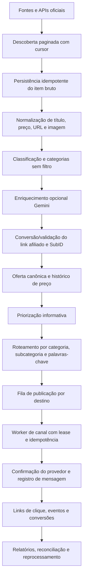
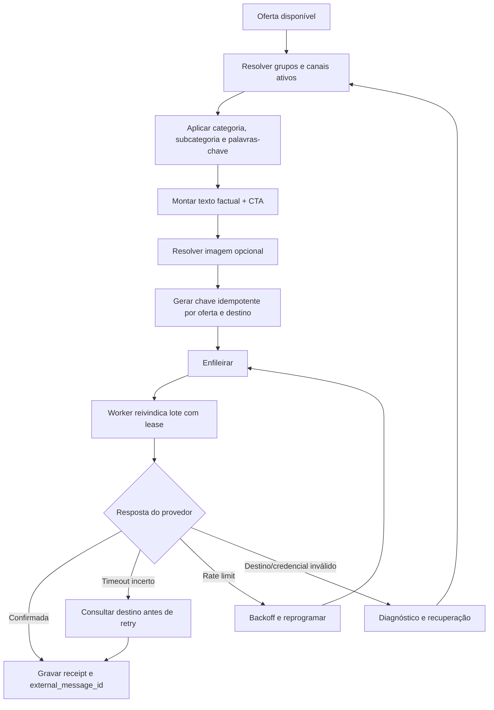

# REGRA MASTER E FLUXOS PONTA A PONTA — RADAR PROMO BRASIL

**Versão:** 1.0  
**Data da auditoria:** 08/11/2026  
**Projeto:** Radar Promo Brasil  
**Produção observada:** Hatchable v655 LIVE  
**GitHub:** `emersongabriel29-pixel/radar-promo-brasil`, branch `main`, baseline documental `db156b23ef64b83cbe85fa296b3761364e5073f0`  
**Status deste documento:** especificação mestre aprovada pelo titular; implementação integral ainda em auditoria e harmonização. Este documento não declara fluxos como funcionais sem teste ponta a ponta.

---

## 1. Regra Master — prioridade máxima

O Radar Promo Brasil deve descobrir, importar, organizar, enriquecer, converter links, distribuir e publicar oportunidades de afiliados com o máximo de abrangência permitido pelas APIs oficiais e pelos canais conectados.

### 1.1 O que NÃO pode limitar uma oferta

Não usar como motivo interno para descartar, bloquear, rejeitar, ocultar, deixar indefinidamente pendente ou impedir o processamento:

- Categoria, subcategoria, palavra-chave, nicho ou classificação comercial.
- Produto adulto / +18, por sua categoria ou idade.
- Desconto mínimo, preço mínimo, score mínimo ou nota mínima.
- Comissão mínima, quantidade de vendas, popularidade ou avaliação mínima.
- Idade da oferta, desde que a fonte ainda a reconheça como disponível.
- Falta temporária de imagem, preço secundário, descrição, cupom ou metadado enriquecido.
- Falta temporária de link afiliado quando a integração oficial ainda pode gerá-lo.
- Baixa confiança da IA ou ausência de resposta da IA.
- Ordem de prioridade, volume de uma loja ou concentração de categoria.

Score, comissão, avaliação, desconto, popularidade e confiança são sinais informativos para ordenação, relatórios e texto — nunca gates de elegibilidade.

### 1.2 Único limitador operacional interno

A única limitação interna de processamento é a capacidade real da hospedagem: tempo máximo de execução, quota diária, limite de transações, concorrência, memória, chamadas de funções e capacidade de banco.

Quando a capacidade acabar:
1. Persistir o item e o ponto de continuação antes de encerrar.
2. Marcar o trabalho como aguardando capacidade/reagendamento, nunca como oferta rejeitada.
3. Guardar cursor, página, lote, tentativas, última etapa concluída e próximo horário.
4. Retomar automaticamente no próximo ciclo disponível, sem recomeçar do zero.
5. Usar lotes adaptativos, paginação, backoff exponencial com jitter, cache e idempotência.
6. Nunca criar um one-shot por produto/oferta; preferir crons recorrentes e workers que drenam lotes.
7. Não ultrapassar quotas do plano nem provocar tempestades de retry.
8. Exibir no painel o motivo operacional, quantidade preservada, próximo processamento e idade da fila.

O limite da hospedagem regula **quando e em que lote** o Radar trabalha; não decide **quais produtos merecem existir**.

### 1.3 Condições técnicas e externas — não são filtros comerciais

O Radar deve preservar e recuperar itens mesmo quando houver:
- Link temporariamente ausente/inválido, preço não retornado, imagem indisponível, produto fora de estoque ou metadado incompleto.
- Falha temporária, timeout, rate limit ou indisponibilidade da API.
- Credencial ausente/expirada, autorização de campanha/canal ainda não concedida ou destino desconectado.
- Recusa do provedor ou limitação documentada do canal.

Nesses casos, não apagar nem classificar a oferta como rejeitada por preferência comercial. Registrar a dependência exata, tentar novamente quando tecnicamente possível e apresentar a ação necessária quando depender de autorização externa. Não inventar preço, disponibilidade, link afiliado, comissão ou confirmação de publicação.

A implementação deve cumprir leis, políticas oficiais das APIs e regras dos canais. Não contornar autenticação, autorização, limites, CAPTCHA ou proteções antiautomação. A regra de ausência de filtro por categoria não transforma uma operação proibida pelo provedor em operação permitida.

### 1.4 Duplicidade, fraude e integridade

- Duplicatas não podem causar perda do produto ou de seus dados. Consolidar referências e histórico sob uma identidade canônica; preservar URLs, fontes, SubIDs, campanhas e eventos.
- Um item semelhante não é automaticamente duplicado: comparar identificadores, variante, loja, URL canônica e atributos.
- Dados suspeitos, alegações enganosas, spam, links maliciosos ou origem não confiável devem ser sinalizados e investigados; não apagar o registro original.
- Nunca publicar preço, desconto, estoque, cupom, comissão ou alegação que não tenha evidência na fonte.
- O Radar não deve criar links que pareçam afiliados sem validação do provedor.

---

## 2. Semântica obrigatória dos estados

Os estados técnicos são rastreamento de execução, não julgamento do produto.

- **Descoberto/capturado:** o registro foi persistido; não pode ser perdido.
- **Processando:** um worker possui lease temporário. Se expirar, outro worker recupera.
- **Aguardando capacidade:** pausa exclusivamente operacional, com próximo ciclo/cursor persistido.
- **Aguardando fonte/provedor:** dependência externa identificada, com retry e diagnóstico.
- **Pronto para link:** possui dados suficientes para solicitar/validar link afiliado.
- **Linkado:** link foi gerado/validado pelo provedor e SubID rastreável foi preservado.
- **Disponível para distribuição:** conteúdo factual e destino estão prontos.
- **Na fila de canal:** publicação idempotente criada para um destino conectado.
- **Enviado/publicado:** confirmação do provedor ou receipt externo persistido.
- **Falha recuperável:** erro técnico com próxima tentativa definida.
- **Falha externa terminal:** somente quando o provedor comprovar que não há operação possível; manter histórico e permitir reabertura.

**Não pode existir estado final genérico PENDING, NEEDS_REVIEW, BLOCKED ou FAILED sem proprietário, causa, próximo passo e política de recuperação.** Estados transitórios podem existir durante uma execução curta, mas não podem virar estacionamento indefinido. O objetivo operacional é zero oferta abandonada/sem próxima ação; não é maquiar contagens renomeando status.

---

## 3. Fluxo mestre de ponta a ponta

Em qualquer etapa, erro transitório retorna à etapa exata com cursor e dados preservados. Nenhuma etapa usa score, desconto, categoria ou +18 para descartar.

---

## 4. Fluxos por origem

### 4.1 APIs de afiliados e marketplaces

Rotas atualmente inventariadas incluem Shopee, Lomadee, AliExpress, Mercado Livre, Magalu, Rakuten, Admitad, Awin, Amazon, Temu e SHEIN. A existência de rota não comprova que o provedor oferece API pública, que a credencial está configurada ou que a operação foi homologada.

Para cada provedor, o fluxo obrigatório é:

1. Ler credencial do cofre/configuração segura da conta, sem expor segredo.
2. Verificar autorização, escopos, campanhas, canais e limites documentados.
3. Descobrir produtos/ofertas em páginas/lotes, salvando cursor e resposta bruta.
4. Fazer upsert por conta + provedor + ID externo; deduplicar sem perder variantes.
5. Normalizar dados e preservar payload original.
6. Classificar categoria/subcategoria e tags sem bloquear categoria.
7. Gerar link afiliado pelo endpoint oficial; preservar URL original, URL afiliada, campanha, canal e SubID.
8. Atualizar preço/histórico apenas com dados recebidos da fonte; não inventar desconto.
9. Criar/atualizar oferta canônica sem criar publicação duplicada.
10. Encaminhar para os destinos correspondentes e registrar resultado.

**Shopee:** preservar cursores de descoberta, rotação de palavras-chave/famílias, chamadas GraphQL oficiais, retry de códigos transitórios, links e SubIDs. Remover gates de categoria/medicamento/+18 e thresholds comerciais como condição interna, sem alterar assinatura/autenticação da API.

**Lomadee:** separar descoberta de produtos/campanhas/marcas/canais, criação de links, validação de short URL e reconciliação. Não perder os itens já capturados. Estados históricos `BLOCKED_PROVIDER_APPROVAL` e `BLOCKED_PROVIDER_CHANNEL` significam dependência do provedor, não autorização para descartar o item. `BLOCKED_SAFETY` não deve ser usado como filtro de categoria interno; manter item e rastreio. A autorização externa da Lomadee não pode ser simulada.

**AliExpress:** manter descoberta paginada, produtos, campanhas, links de promoção, preço e comissões informados. Remover desconto mínimo, avaliação/comissão mínima e filtro de categoria como gate interno. O link precisa ser efetivamente emitido pelo provedor antes de distribuição.

**Mercado Livre:** manter OAuth, callback, notificações, parsing de links, criação de links e SubID por grupo; renovar tokens conforme documentação oficial e reconciliar notificações sem duplicidade.

**Magalu, Rakuten, Admitad, Awin, Amazon, Temu e SHEIN:** classificar individualmente como não implementada, implementada não configurada, configurada não validada, testada com sucesso ou bloqueada por autorização/documentação externa. Não apresentar rota ou tela como integração concluída.

### 4.2 Captura manual, extensão e modo clone

1. Receber URL/texto/imagem e identificar fonte.
2. Persistir evento bruto e conta de origem.
3. Extrair identificadores e resolver página/API oficial.
4. Criar/atualizar item sem duplicar.
5. Converter para link afiliado da conta quando permitido pelo provedor.
6. Aplicar categorias e destino conforme configuração.
7. Encaminhar para fila e relatório.
8. Retornar ao usuário protocolo/status e não exigir novo compartilhamento para retomar o processamento.

Falha na extração ou na conversão mantém o registro e agenda resolução; nunca descarta silenciosamente.

---

## 5. Categorias, subcategorias e palavras-chave

- Classificação é universal e independente da API.
- Toda oferta recebe categoria/subcategoria quando houver evidência; caso contrário, usa categoria genérica e continua no fluxo.
- Palavras-chave e tags ampliam descoberta e roteamento; não são filtros de descarte.
- Uma oferta pode pertencer a várias tags/categorias sem criar cópias.
- Grupo sem categoria específica recebe ofertas gerais; grupos específicos recebem correspondências, sem eliminar oferta que não encontrou grupo.
- O foco atual Casa & Lar deve ser roteamento prioritário, não exclusividade nem bloqueio de outras categorias.
- Reclassificação posterior não apaga publicação, histórico, cliques ou atribuição.

---

## 6. Gemini e demais recursos de IA

A IA é enriquecimento, nunca porteira de entrada.

- Pode gerar chamada curta, CTA, título auxiliar, categoria, subcategoria, tags e texto promocional.
- Deve diferenciar “oferta”, “oferta relâmpago”, “Black Friday”, cupom e outras campanhas somente quando a fonte fornecer evidência; sem evidência, usar chamada neutra.
- Não inventar urgência, estoque, preço anterior, desconto, frete, comissão, avaliações ou atributos.
- Falha, quota 429 ou indisponibilidade Gemini não interrompe a oferta: usar template determinístico e retomar enriquecimento depois.
- Cache por fingerprint, limite de tokens, lote adaptativo e backoff protegem a hospedagem.
- A chamada de IA não pode mudar status para rejeitado nem criar pendência permanente.

---

## 7. Links afiliados, preço e atribuição

- Cada oferta deve manter URL de origem, URL final, URL afiliada, provedor, campanha, canal, SubID e histórico de alterações.
- SubID deve identificar destino/grupo quando suportado.
- Link encurtado só é considerado válido após confirmação no endpoint oficial ou teste seguro de resolução.
- Não substituir link afiliado por link comum sem sinalizar.
- Preço ausente não autoriza invenção; a mensagem pode omitir preço até atualização.
- Histórico de preço registra fonte, moeda, timestamp e valor bruto/normalizado.
- Não exigir desconto mínimo ou histórico de preço como condição para manter a oferta.
- Duplicatas preservam todas as origens e atribuições.

---

## 8. Publicação WhatsApp e Telegram

- WhatsApp e Telegram têm filas, credenciais, limites e workers independentes.
- Uma falha de canal não bloqueia outra plataforma nem outra API.
- Não criar mensagem duplicada; usar idempotency key e receipt.
- Timeout incerto exige reconciliação antes de reenviar.
- Rate limit do canal provoca espera/retry, não rejeição da oferta.
- Destino sem conexão fica como dependência do destino; a oferta permanece no catálogo e pode seguir para outros destinos.
- Imagem é opcional quando o canal aceitar texto; não perder oferta por falha de mídia.
- Horários e intervalos configurados controlam ritmo do canal, não a elegibilidade do produto.
- Publicação só é confirmada com resposta/receipt do provedor.

---

## 9. Hospedagem, scheduler e proteção contra perda

- Priorizar crons recorrentes declarados e workers que processam lotes.
- Evitar `scheduler.at()` por item; consolidar tarefas.
- Cursor por provedor/conta/operação e checkpoint por lote.
- Claim transacional com `FOR UPDATE SKIP LOCKED`, lease, idempotência e recuperação de leases expirados.
- Limite adaptativo por duração, erros, quota remanescente e janela do plano.
- Backoff exponencial com jitter; respeitar `Retry-After` quando fornecido.
- Não executar fan-out ilimitado por conta ou provedor.
- Circuit breaker apenas pausa chamadas à fonte indisponível; não pausa o catálogo nem outras fontes.
- Registrar execução, lote, itens lidos/criados/atualizados, chamadas externas, duração, quota, erro e cursor.
- Alertar quando fila envelhece, cursor não avança, cron não dispara, erro 5xx aumenta ou quota aproxima do teto.
- Toda pausa operacional precisa de próximo horário e rotina de retomada automática.

---

## 10. Relatórios e observabilidade

Painel deve exibir por fonte, categoria e destino:
- Descobertos, capturados, linkados, prontos, enfileirados, publicados, cliques, conversões e comissões.
- Itens em processamento, aguardando capacidade, aguardando provedor e falhas recuperáveis, sempre com causa e próximo passo.
- Itens sem cursor/sem próxima tentativa (meta: zero).
- Tentativas, taxa de sucesso, idade máxima da fila, chamadas API, quotas e duração.
- Publicações confirmadas vs incertas vs falhas.
- Duplicatas consolidadas e referências preservadas.
- Estado de credenciais e integrações, sem revelar segredos.

Não apresentar “ofertas bloqueadas” como decisão comercial. Exibir dependências técnicas e externas separadamente.

---

## 11. Dados existentes — fotografia da auditoria de 08/11/2026

Consulta read-only executada no banco real do Hatchable v655:

- Ofertas: 8.020 total; 3.985 `APPROVED`, 4.035 `PENDING`.
- Validação: 3.951 `VALIDATED`, 4.035 `NEEDS_REVIEW`, 26 `REJECTED` (motivo dominante: URL de produto duplicada/variante), além de estados residuais.
- Classificação: 4.998 `REVIEW`, 2.945 `AUTO`, 42 `MANUAL`, 35 `CLASSIFIED`.
- Descoberta Lomadee PRODUCT: 1.835 `READY_FOR_LINK`, 351 `LINKED`, 159 `DISCOVERED`, 161 `BLOCKED_SAFETY`, 27 `BLOCKED_PROVIDER_APPROVAL`, 17 `BLOCKED_PROVIDER_CHANNEL`, 662 `DUPLICATE`, 26 `NEEDS_DATA`.
- Descoberta Shopee PRODUCT: 66.458 `DISCOVERED`, 2.052 `IMPORTED`, 184 `BLOCKED`, 75 `DUPLICATE`, 15 `INCOMPLETE`.
- Descoberta AliExpress PRODUCT: 9.639 `CAPTURED`, 825 `LINKED`, 17 `BLOCKED_SAFETY`, 16 `DISCOVERED`, 20 `NEEDS_ENRICHMENT`.
- Publicações: 2.726 `PUBLISHED`, 2.333 `READY`, 136 `FAILED`, 37 `RETRY`, 4 `WAITING_CONFIRMATION`.

Esses números são fotografia pontual, não garantia de estado futuro. Nenhum dado foi alterado nesta auditoria. Não executar limpeza em massa, reclassificação ou publicação em massa sem reconciliação por lote, idempotência e teste de segurança.

---

## 12. Pendências técnicas já comprovadas

1. Harmonizar a Regra Master com os gates legados de medicamento, desconto mínimo, comissão/avaliação, score e classificação REVIEW.
2. Corrigir o funil Lomadee: descoberta, normalização, geração/validação de link e reconciliação dos 1.835 itens READY_FOR_LINK e 159 DISCOVERED sem perda.
3. Auditar e recuperar 4.035 ofertas PENDING/NEEDS_REVIEW; não aprovar em massa sem checar identidade, fonte e integridade dos campos.
4. Recuperar itens BLOCKED/INCOMPLETE/NEEDS_DATA com nova tentativa e enriquecimento, sem apagar histórico.
5. Revisar a regra de duplicidade: consolidar referências/variantes, preservar todos os links e não rejeitar variantes legítimas.
6. Revisar `lib/delivery.js`: hoje exige oferta APPROVED/PUBLISHED, VALIDATED/APPROVED, classificação diferente de REVIEW, preço positivo, link HTTPS, imagem e histórico oficial de preço nas últimas 24h. Esses gates comerciais/de metadados conflitam com a Regra Master e precisam ser substituídos por pré-condições técnicas mínimas, sem publicar dados inventados.
7. Harmonizar autopilot, Shopee, AliExpress, Lomadee, Gemini e os demais workers para usar uma política comum.
8. Corrigir excesso de one-shots e quota do scheduler: auditoria anterior encontrou 200 tarefas one-shot/dia no plano e rejeições HTTP 422 quando o projeto excedeu esse limite.
9. Investigar erros observados nos jobs: hourly 40/147, Lomadee link queue 12/125, Shopee 6/119 e Telegram 1/478 em janela de 7 dias na fotografia anterior; diagnósticos Telegram também tiveram respostas 5xx.
10. Completar homologação de cada API/canal e confirmar a sincronização dos arquivos funcionais GitHub ↔ Hatchable.
11. Executar build, testes unitários, E2E e auditoria de dependências; os testes npm não foram executados nesta auditoria documental.
12. Implementar painel de saúde das filas com causa, cursor, próxima tentativa, idade e recuperação.

---

## 13. Critérios objetivos de conclusão ponta a ponta

Um fluxo só pode ser marcado como **TESTADO COM SUCESSO** quando houver evidência de:

1. Credencial/autorização validada sem expor segredo.
2. Chamada real de leitura ao provedor, com resposta documentada.
3. Cursor/paginação avançando e dados persistidos sem duplicidade.
4. Item preservado mesmo com metadado incompleto ou falha transitória.
5. Classificação sem filtro por categoria/+18/score/desconto/comissão/avaliação.
6. Link afiliado gerado/validado oficialmente, com SubID quando suportado.
7. Oferta canônica e histórico atualizados.
8. Roteamento correto por categoria e destino.
9. Publicação de teste em ambiente isolado ou sandbox oficial; nunca enviar mensagem real durante teste sem autorização expressa.
10. Idempotência, retry, rate limit, timeout incerto e recuperação testados.
11. Cliques/conversões reconciliados quando o provedor disponibilizar esses eventos.
12. Relatório e logs coerentes.
13. Documentação atualizada na mesma tarefa.
14. Commit, deploy e equivalência GitHub ↔ Hatchable verificados separadamente.

Status permitidos: **NÃO IMPLEMENTADO**, **IMPLEMENTADO NÃO CONFIGURADO**, **CONFIGURADO NÃO VALIDADO**, **TESTADO COM SUCESSO**, **BLOQUEADO POR ACESSO/PROVEDOR**. Nunca inferir sucesso pela existência de tela, rota ou credencial.

---

## 14. Ordem obrigatória de execução para concluir

1. Congelar e registrar fotografia de banco, filas, cursores, cron e manifesto; não excluir nem limpar.
2. Corrigir documentação e instruções de desenvolvimento para que a Regra Master seja a fonte normativa.
3. Mapear cada gate legado em todas as fontes e pontos de publicação.
4. Implementar política comum e migração compatível, sem destruir histórico.
5. Criar testes unitários e de integração para produto +18, categoria, desconto zero, comissão zero/ausente, avaliação ausente, IA indisponível, imagem ausente, link pendente, rate limit e retomada de cursor.
6. Homologar cada provedor isoladamente, sem publicar em canal real.
7. Reprocessar backlog em lotes pequenos, com checkpoints e reconciliação; preservar todos os IDs e referências.
8. Validar fila de publicação e reconciliação de receipts em ambiente seguro.
9. Testar scheduler abaixo da quota e provar retomada após interrupção.
10. Atualizar relatórios, alertas e documentação.
11. Comparar os arquivos alterados no GitHub e Hatchable; revisar commit e versão implantada.
12. Só então declarar o fluxo concluído. Qualquer dependência externa real deve aparecer como bloqueio externo identificado, nunca escondido como sucesso.

---

## 15. Regra permanente de documentação

Toda alteração — código, banco, configuração, integração, prompt, categoria, fila, worker, cron, segurança, interface, teste, deploy ou rollback — deve atualizar este documento ou o documento de domínio correspondente na mesma tarefa. Registrar motivo, arquivos/rotas/tabelas, comportamento anterior/novo, riscos, testes, resultados, commit, versão Hatchable, sincronização e rollback. Sem documentação e evidência, a alteração não está concluída.

**Regra final:** nenhuma oferta se perde; nenhuma categoria é excluída por decisão interna; nenhuma falha transitória vira descarte; a hospedagem controla o ritmo, e o Radar retoma automaticamente o trabalho.

## 16. Evidências de gates legados encontrados no código

Levantamento estático/read-only em 08/11/2026. Os arquivos abaixo precisam ser harmonizados com a Regra Master em uma etapa de implementação com testes:

| Arquivo | Regra atual observada | Ajuste exigido |
|---|---|---|
| `lib/delivery.js` | Exige oferta APPROVED/PUBLISHED, validation VALIDATED/APPROVED, classificação diferente de REVIEW, preço positivo, link HTTPS, imagem e histórico oficial de preço nas últimas 24h | Remover classificação/score/histórico/imagem como gates; permitir texto sem preço/imagem; encaminhar link ausente para geração; manter integridade do link antes do envio |
| `lib/autopilot.js` | Considera somente APPROVED e exclui classificação REVIEW; AliExpress exige VALIDATED | Fazer processamento universal sem gates comerciais/classificação; não criar publicação duplicada |
| `api/jobs/ai-enrichment.js` | Lê apenas PENDING + REVIEW, limita a cinco por execução e deixa status PENDING; erros não-quota recebem marca ai_failed que impede nova tentativa | IA opcional, fallback determinístico e retry persistente; limite por execução deve ser capacidade adaptativa, nunca deixar oferta sem próxima tentativa |
| `api/jobs/aliexpress-review.js` | Exige desconto >=10%, bloqueia medicamentos e segura LOW_COMMISSION/LOW_RATING/VARIANT_PRICE_RANGE | Retirar gates comerciais e de categoria; métricas ficam informativas; preservar os dados de preço reais |
| `api/jobs/aliexpress.js` | Registra BLOCKED_SAFETY para medicamento e rejeita produto adulto conforme termos do programa | Remover bloqueio interno por categoria; respeitar as regras oficiais do programa AliExpress para distribuição. Quando o provedor proibir promoção de determinado produto, preservar o item e marcar dependência externa específica, sem apagá-lo |
| `api/integrations/aliexpress.js` | O relatório identifica produtos adultos; a auditoria de campanhas aplica restrições publicitárias informadas pelo provedor | Distinguir diagnóstico de elegibilidade do provedor; não usar categoria como bloqueio geral do Radar |
| `api/integrations/shopee.js` e `api/jobs/shopee.js` | Chamam filtro de medicamentos na integração/descoberta; a função de produto adulto também aparece na análise de candidatos | Remover exclusões internas por categoria; manter autenticação, integridade, limites e regras oficiais da Shopee |
| `api/jobs/extension-autopublish.js` | Bloqueia medicamento, classificação REVIEW e LOW_COMMISSION/LOW_RATING | Remover gates comerciais/classificação e preservar o item em recuperação quando faltarem dados/link |
| `api/jobs/lomadee-discovery-queue.js`, `api/jobs/lomadee-link-queue.js`, `lib/lomadee-catalog.js` | Classificação de medicamento produz BLOCKED_SAFETY | Não descartar por categoria; preservar item, tentar conversão de link e separar exigência externa real da política interna |
| `api/jobs/lomadee-reconcile.js` | Filtra ofertas por medicamento antes de reconciliar links | Reconciliar todos os itens e manter rastreabilidade; restrição externa deve ser identificada pelo provedor |
| `api/radar/autopilot.js` | Defaults de min_score 85 e min_discount 15; persiste max_publications_per_day e cooldown | Esses campos não podem funcionar como bloqueio comercial; converter métricas em prioridade informativa |
| `api/social/autopilot.js` | Persiste min_score, max_posts_per_day, intervalo e janela horária | Limites de execução do canal/hospedagem podem cadenciar, mas não descartar itens; manter regras oficiais do canal |

**Exceção externa importante:** o código atual identifica uma restrição do programa de afiliados AliExpress para publicidade de produtos adultos (com exceções descritas pelo próprio programa). A Regra Master remove a proibição interna genérica do Radar, mas não autoriza violar termos oficiais de um provedor. O item deve permanecer salvo e rastreável, e o relatório deve dizer que o destino/provedor não permite aquela distribuição. Não marcar como oferta perdida.

### Registro da etapa documental anterior

A etapa documental identificou os gates legados e não alterou código ou banco. A implementação inicial descrita abaixo foi realizada posteriormente e está versionada separadamente.

## 17. Implementação inicial da Regra Master — versão de fluxo v1

**Estado de preparação:** código gravado no Hatchable como draft; dry-run válido; aguardando publicação controlada.  
**Baseline funcional consultado:** Hatchable v658 LIVE e GitHub `main` antes das alterações.  
**Migração:** `migrations/066_master_offer_flow_policy.sql`.

### 17.1 O que mudou no código

- Criado `lib/offer-flow-policy.js`: elegibilidade comum exige apenas título, preço atual positivo em centavos, link afiliado HTTPS sem credenciais e ausência de rejeição explícita por integridade.
- `lib/autopilot.js`: processa APPROVED, PENDING, READY e NEEDS_REVIEW; não exige aprovação prévia, classificação diferente de REVIEW, desconto, comissão, avaliação, imagem ou histórico de preço. Lotes padrão de até 200 por conta/ciclo (máximo técnico por execução). Itens já presentes na fila de publicações não são inseridos novamente.
- `api/jobs/autopilot.js`: acorda contas com ofertas elegíveis sem exigir imagem/histórico oficial recente; extensão segue o mesmo princípio.
- `lib/delivery.js`: adicionada política versionada. Novas publicações `master_v1` validam título, preço atual e link afiliado, sem gates comerciais/classificação/imagem/histórico. Telegram e Canal do WhatsApp aceitam texto com link quando a imagem não existe ou falha ao baixar/armazenar; imagem é enriquecimento opcional. A tentativa de cache de imagem tem timeout de 1s para proteger o tempo de execução. Publicações antigas continuam `legacy` e mantêm as regras antigas até reconciliação explícita, evitando liberar 2.329 READY/37 RETRY antigos em massa.
- Novas publicações gravam `eligibility_policy_version='master_v1'`; quando inseridas, a oferta passa a status READY. A confirmação final de envio continua dependendo do receipt do canal.
- AliExpress review e extensão deixam de rejeitar por medicamento, imagem, desconto, comissão, avaliação ou REVIEW; faltas técnicas são contabilizadas como adiamento, não rejeição comercial.
- Shopee: filtros internos de medicamento e exigências de imagem/comissão removidos da descoberta e importação; registros antigos BLOCKED/INCOMPLETE com dados técnicos suficientes são retomados. A publicação nos canais não exige imagem.
- Lomadee: removedor o gate interno de medicamento, imagem não é pré-requisito e registros BLOCKED_SAFETY/NEEDS_DATA com dados essenciais são recolocados em READY_FOR_LINK. Reconciliação não rebaixa oferta para PENDING só porque não há desconto.
- AliExpress: medicamento não é mais filtro interno e imagem é opcional. A restrição oficial do programa para publicidade de determinados produtos adultos permanece como restrição do provedor, identificada como `PROVIDER_RESTRICTED`; não pode ser contornada.
- Amazon: medicamento, imagem e desconto deixaram de ser gates internos; Partner Tag/URL HTTPS e preço atual continuam obrigatórios.
- Comissão, avaliação, desconto, score e imagem continuam disponíveis como sinais informativos para ordenação e relatório.

### 17.2 Preservação e limites de segurança

- A migração adiciona `publications.eligibility_policy_version` com default `legacy`; não altera nem reenvia publicações antigas.
- O autopilot exclui `validation_status='REJECTED'` e `status='REJECTED'` até reconciliação canônica de duplicidade/integridade. Os 26 casos identificados não serão publicados em duplicidade; a política Master também exclui status PROVIDER_RESTRICTED, usado apenas para restrição externa específica do programa AliExpress.
- Não foi executado SQL de aprovação em massa, não foram acionados workers manualmente e nenhuma mensagem foi enviada durante esta etapa.
- Não foi executada chamada real às APIs externas durante testes. O processamento real seguirá os crons configurados e limites oficiais dos provedores/canais.
- O lote de 100 por conta por ciclo é controle de capacidade/continuidade da hospedagem; não é limite comercial. Checkpoints são as próprias filas e o registro de publicações idempotentes.
- Os registros antigos `legacy` permanecem preservados e precisam de reconciliação antes de eventual migração para `master_v1`.

### 17.3 Validação e pendências honestas

- Dry-run Hatchable: `ok=true`, 0 erros, 0 avisos; 122 funções API, 9 páginas, 72 migrações; próxima versão prevista v659.
- Sete testes unitários adicionados em `tests/master-offer-flow.test.mjs`, cobrindo +18 sem filtro global, score/desconto/comissão/avaliação ausentes, imagem/histórico opcionais, link inválido, duplicidade rejeitada e restrição externa por provedor. Os testes ainda não foram executados neste ambiente.
- `npm run build`, `npm test`, `npm run test:e2e` e `npm audit --audit-level=moderate` ainda não foram executados.
- Não foi feita homologação ponta a ponta com APIs/canais, pois isso exigiria operações reais ou sandbox documentado.
- O backlog anterior de ofertas e publicações não foi alterado nesta etapa. A retomada automática começará após o deploy e o próximo ciclo dos crons. A contagem de pendências deve ser atualizada depois de cada lote.

### 17.4 Fotografia atual do backlog antes do deploy v659

Consulta read-only executada em Hatchable v658 após preparar o código:

| Origem | Ofertas elegíveis sem publicação | Observação |
|---|---:|---|
| Lomadee | 4.002 | Status PENDING; link e preço atual presentes; seguirá em lotes de 100 por conta/ciclo |
| AliExpress | 26 | 21 APPROVED + 5 PENDING; os itens adultos sujeitos a termos do programa ficam separados em PROVIDER_RESTRICTED |
| Shopee | 8 | Status APPROVED, sem publicação existente |
| **Total elegível sem publicação** | **4.036** | Não foram inseridas publicações nem alterados status nesta consulta |

Outros registros preservados:
- 26 ofertas com `validation_status=REJECTED` (duplicidade/integridade): aguardam reconciliação canônica, não são descartadas nem reenviadas.
- Publicações existentes: 2.329 READY, 37 RETRY, 136 FAILED, 4 WAITING_CONFIRMATION e 2.746 PUBLISHED.
- Descoberta Lomadee: 161 BLOCKED_SAFETY e 26 NEEDS_DATA; o código recoloca em processamento os registros com campos técnicos essenciais.
- Descoberta Shopee: 184 BLOCKED e 15 INCOMPLETE; o código recupera os que já têm título, preço, URL de produto e link afiliado.
- Descoberta AliExpress: 17 BLOCKED_SAFETY; serão reavaliados quando a fonte os retornar novamente. Restrição adulta oficial continua isolada em PROVIDER_RESTRICTED.
- Lomadee com BLOCKED_PROVIDER_APPROVAL/CHANNEL (27/17) depende de autorização externa; não há contorno permitido.

A fila de 4.036 será processada pelo scheduler em lotes. O número de ofertas elegíveis não equivale a mensagens enviadas; a publicação depende de grupos ativos, receipt e intervalo/rate limit dos canais.

### 17.5 Fallback de mídia

O dispatcher Telegram agora usa `sendPhoto` quando existe imagem válida e `sendMessage` com link afiliado quando a imagem falta ou falha. O Canal do WhatsApp também permite mensagem textual sem mídia e usa cache de imagem apenas quando possível. Erro de mídia não vira falha definitiva quando o canal aceita texto. A métrica `published` do autopilot foi corrigida: enfileiramento nunca é contado como publicação. Erros reais de transporte, autorização e rate limit continuam com retry/diagnóstico.

## 18. Cadência e orçamento de execução — v661

O plano Free do Hatchable impõe frequência mínima de uma hora para crons declarados. A implantação não pode declarar crons de 5 ou 15 minutos; o dry-run rejeita essas frequências. Para acelerar o fluxo sem exceder a quota de one-shots:

- `/api/jobs/autopilot`: cron horário no minuto 5; lote padrão de 100 ofertas por conta, máximo 200 por chamada.
- `/api/jobs/extension-autopublish`: cron horário no minuto 50.
- `/api/jobs/telegram`: cron horário como rede de segurança; lote de 14 por turno.
- Quando o autopilot cria novas publicações Telegram, arma **um único wake-up central por conta/lote** para o horário `next_turn_at`. Nunca agenda um one-shot por produto ou por publicação.
- Configuração da conta ativa: `interval_minutes=5`, `batch_size=14`. Isso permite o cron horário de segurança e um despacho adicional após a ingestão do lote.
- Telegram espera 3,1s entre mensagens para respeitar aproximadamente 20 mensagens/minuto por grupo. Cache de imagem tem timeout de 1s; se mídia falta ou falha, o envio textual com link afiliado continua.
- O fluxo automático de ofertas não usa mais `scheduler.now()` por importação/extensão. One-shots restantes são no máximo um wake-up central por lote; tarefas de recorrência e mídia são workflows distintos.
- WhatsApp não foi ativado: há zero `whatsapp_connections`, grupos pausados e sem `external_id`. O worker aceita texto sem imagem, mas precisa de conexão válida e destino autorizado. Isso não bloqueia o catálogo nem Telegram.
- Descoberta e conversão de links continuam em crons próprios, respeitando quotas oficiais das APIs. Lomadee link queue permanece horária e em lote 10 até homologação de rate limits.

**Capacidade estimada:** autopilot pode colocar até 200 ofertas/hora por conta na fila. O dispatcher Telegram processa até 14 por turno, com até dois turnos por hora quando há wake-up e cron. Essa é a cadência segura disponível no plano atual, não um filtro comercial. Para aumentar frequência declarada além de uma hora, seria necessário um plano Hatchable que permita crons mais frequentes; não foi contratado nem alterado plano.

## 19. Reconciliação de duplicatas e retomada da fila legada — v663

### 19.1 Duplicatas Lomadee corrigidas sem perda

A consulta read-only encontrou 26 registros com `validation_status=REJECTED`, todos com motivo legado de duplicidade por URL:

- **17** tinham URL de variante exatamente igual a outra oferta canônica, mesmo preço e mesmo link afiliado; nenhuma das linhas duplicadas tinha publicação. Foram consolidadas com `canonical_offer_id`, status `DUPLICATE_MERGED` e validação `MERGED`. Os registros originais, links e histórico permanecem no banco.
- **9** tinham parâmetros `variant=` únicos, sem oferta canônica com a mesma URL, preço positivo e link afiliado Lomadee HTTPS. Foram restauradas para `VALIDATED`; continuam ofertas independentes.
- Resultado após reconciliação: **0 ofertas com validation_status REJECTED** entre esses registros. Não houve DELETE nem exclusão de histórico.

A migração `067_offer_canonical_merge.sql` adiciona `offers.canonical_offer_id`. A deduplicação preserva os parâmetros de variante/modelo/SKU; apenas parâmetros de rastreamento são removidos na comparação.

### 19.2 Migração gradual das publicações antigas

Consulta read-only identificou **2.329** publicações antigas em `READY` sob política `legacy`. Todas as 2.329 têm título, preço atual positivo, link afiliado HTTPS e oferta sem rejeição de integridade.

O worker Telegram agora promove no máximo o tamanho de um lote por turno (12) de `legacy` para `master_v1`, somente quando existe grupo Telegram ativo e bot conectado. A promoção e a mudança de oferta para `READY` ocorrem antes do claim transacional; o worker envia dentro do mesmo limite por grupo. Não existe liberação em massa. Estados `RETRY`, `WAITING_CONFIRMATION` e `FAILED` não são reabertos cegamente.

### 19.3 Estado após primeira execução e reconciliação

- Primeiro autopilot real: 100 ofertas avaliadas, 110 publicações enfileiradas, 0 falhas, 0 bloqueios comerciais. A execução horária subsequente também enfileirou outro lote; o dry-run mais recente avaliou 100 e identificou 104 destinos possíveis.
- Ofertas consolidadas: 17 aliases; variantes restauradas: 9; rejeições por duplicidade restantes: 0.
- Ofertas ainda aguardando lotes de capacidade: aproximadamente 3.935 PENDING na fotografia após a primeira execução; o cron horário processa até 100 por conta por ciclo.
- Novas publicações Master: 110 READY, aguardando dispatcher/receipt.
- Publicações antigas READY: 2.329, serão promovidas em lotes de 12 por turno e enviadas gradualmente.
- Nenhuma execução manual de dispatcher foi feita para teste; o envio automático é acionado pelo scheduler já configurado.

A fila continua com trabalho futuro por causa do plano Free (cron mínimo de uma hora), do limite de lote por execução e do rate limit do Telegram. Isso é capacidade de execução, não filtro de elegibilidade de produto.

### 19.4 Ajuste de throughput

Após validar o tempo de execução, o lote padrão do autopilot foi elevado ao máximo técnico de 200 ofertas por conta/ciclo. O dispatcher usa 14 por turno, timeout de mídia de 1s e fallback textual. A configuração do canal ativo foi atualizada para `batch_size=14`, `interval_minutes=5`. A cadência declarada continua horária por exigência do plano Free; o wake-up central após cada lote permite um segundo turno sem agendar tarefas por produto.
