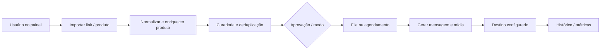

# Arquitetura inferida do Cupom Radar

## Evidência pública

Homepage e FAQ públicas são servidas por uma aplicação que o webEmbedding identificou como Nuxt/Vue. Uma captura estática autenticada referencia bundle `/_nuxt/CoSWBJ4F.js` e CSS com nomes hash. Isso sustenta a hipótese de frontend Nuxt; não identifica versão, SSR/SPA efetivo em todas as rotas, backend ou banco.

## Módulos e limites observáveis

O HTML capturado sugere navegação para postagens, produtos, fila/lista, copiador, curadoria IA, bio link, rotacionador, relatórios e analytics. A FAQ pública descreve tarefas para canais WhatsApp/Telegram, API Shopee, postagem de produto, modos de curadoria e relatórios. Essas informações sustentam capacidades de produto e documentação, não a implementação de serviços internos.

## Modelo de fluxo hipotético

As caixas representam uma arquitetura mínima inferida para explicar os módulos descritos; nenhuma delas foi confirmada por inspeção de servidor.

## Contratos externos

FAQ pública menciona configuração de API da Shopee e conexão de canais. Isso indica dependência de credenciais/aprovação e permissões, sem revelar endpoints, escopos, esquema de dados ou provedor efetivamente conectado. Bundles compilados mostram candidatos de caminhos HTTP, mas sem métodos/contratos validados. Nenhum endpoint privado foi chamado.

## Requisitos para uma implementação equivalente

Separar adaptadores oficiais por marketplace/canal; normalizar dados de produtos; validar preço e link; deduplicar com chave persistida; manter aprovação antes de publicação; armazenar fila e idempotência; renderizar mensagens e mídia; registrar execuções e erros; expor conectividade e autenticação como indicadores separados. São requisitos derivados dos fluxos observáveis, não descrição confirmada da arquitetura atual.
